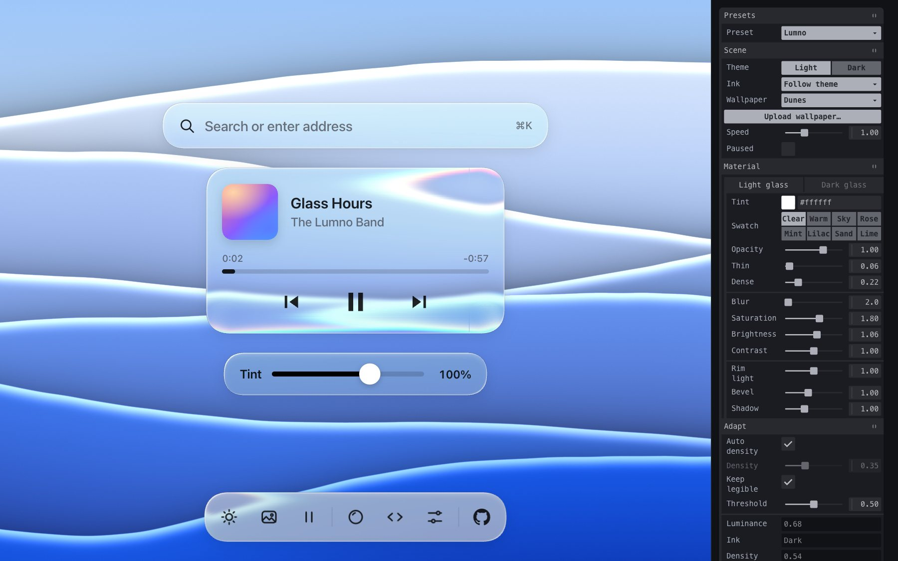
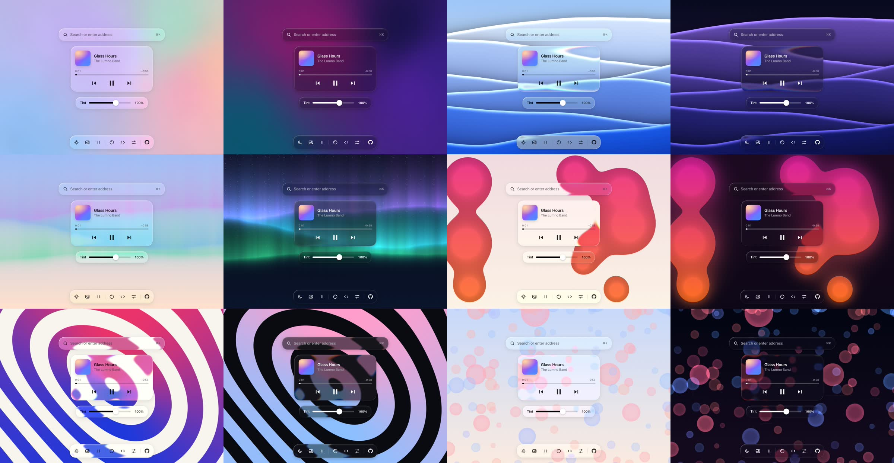
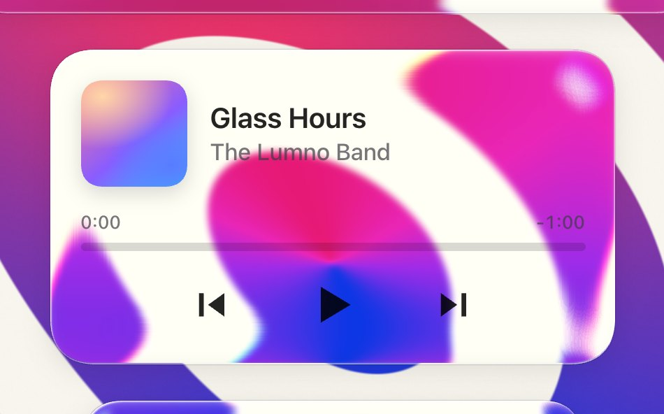
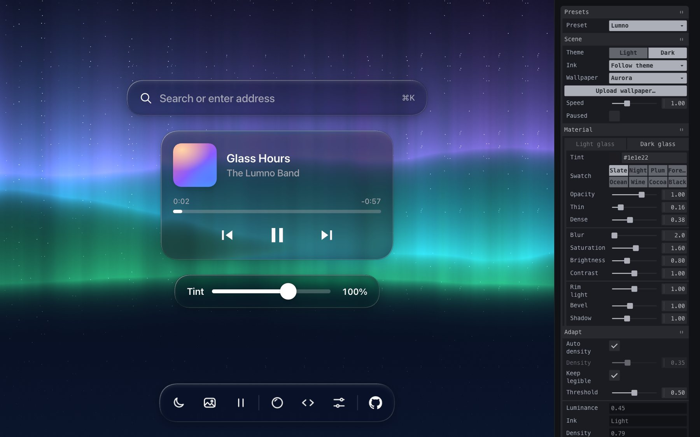
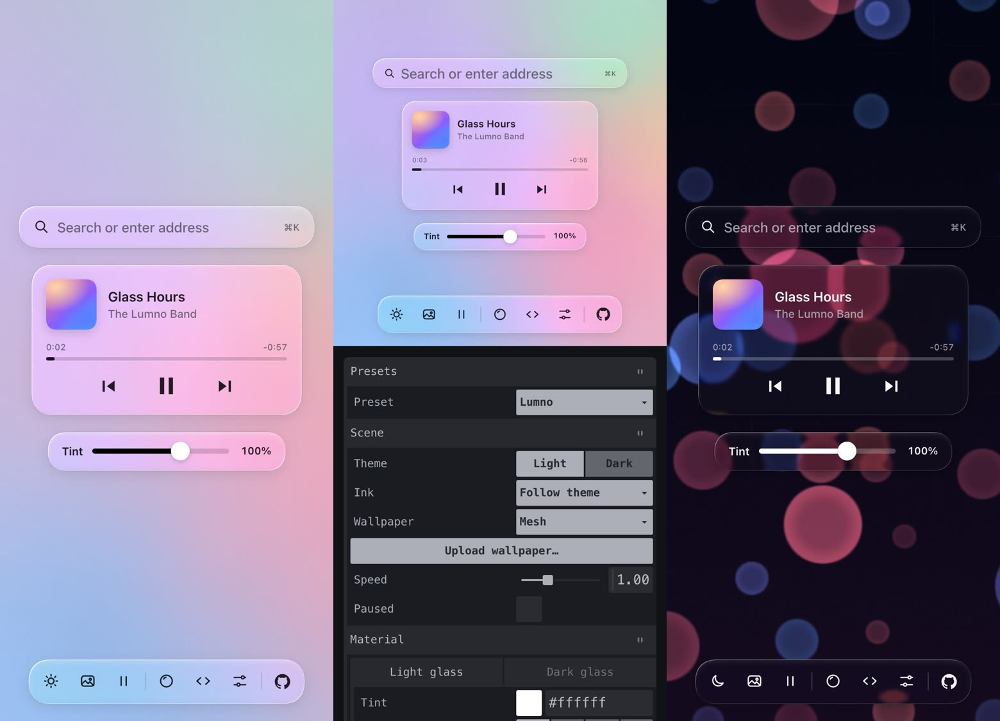

# Glasswork

**English** · [简体中文](README.zh-CN.md)

**A liquid glass material you can take apart, tune and take home.** Glasswork is the glass from [Lumno](https://github.com/kubai087/lumno-extension)'s New Tab page, opened up as a live playground: a thin tint that takes its color from behind, a 2px blur that keeps the scene vivid, a thick rim that bends the wallpaper inward and splits it into colors, rim light and a bevel, and ink that reads the wallpaper under each surface to stay legible. Every part is on a panel, every setting is in the URL, and **Copy CSS** hands you the result.

[](LICENSE)
[](#run-it-locally)
[](#browser-support)
[](https://www.kubai.design/glasswork/)



**[Open the playground](https://www.kubai.design/glasswork/)** · [How the material works](#how-the-material-works) · [Use it in your product](#use-it-in-your-product) · [The prompt](#the-prompt) · [URL parameters](#settings-and-url-parameters)

## Contents

- [Features](#features)
- [Gallery](#gallery)
- [How the material works](#how-the-material-works)
- [Use it in your product](#use-it-in-your-product)
- [The prompt](#the-prompt)
- [Settings and URL parameters](#settings-and-url-parameters)
- [Keyboard shortcuts](#keyboard-shortcuts)
- [Run it locally](#run-it-locally)
- [Project structure](#project-structure)
- [Browser support](#browser-support)
- [Performance](#performance)
- [Contributing](#contributing)
- [Credits, trademarks and the Tahoe wallpaper](#credits-trademarks-and-the-tahoe-wallpaper)
- [License](#license)

## Features

- **The whole material on a panel.** For light glass and dark glass each: tint color with swatches, tint opacity (0–150%), the thin and dense ends of the tint, blur, saturation, brightness, contrast, rim light, bevel and shadow.
- **A refracting thick rim.** An SVG displacement map bends the wallpaper behind the rim inward like the edge of a glass slab and splits it into colors. Rim width, how far the edge bends, falloff and color split are all adjustable, and the map follows CSS `corner-shape: superellipse()` corners.
- **Glass that reads its wallpaper.** Each surface samples the wallpaper under it a few times a second: the tint grows denser over busy or similar-toned patches, a vivid patch keeps less of the saturation boost, and a legibility floor keeps body text at 4.5:1. Ink can follow the theme (the default), follow the wallpaper per surface, or be held dark or light.
- **Seven moving wallpapers.** macOS Tahoe's dynamic wallpaper, and six scenes drawn live in WebGL with a light and a dark look each: Mesh, Dunes, Aurora, Lava, Rings and Bokeh. Or drop in an image or video of your own; it never leaves your browser.
- **Presets.** Lumno, Clear glass, Frosted, Thick slab and Vivid. A preset sets the material's body and refraction only; your tint, opacity, theme, ink, wallpaper and shape stay as you set them.
- **Real surfaces.** A search bar, a now-playing card, a tint slider and a toolbar. Drag any of the first three across the wallpaper (double-click puts it back); the player's buttons drive the wallpaper.
- **Copy CSS.** The material at the settings you see, as plain CSS for light and dark glass, with the one script tag the rim lens needs.
- **Settings in the URL.** Only what differs from the chosen preset is written, so a link opens the same glass.
- **Phones.** The stage fills the screen and the settings open as a sheet from the toolbar.
- **English or Simplified Chinese** (`?lang=zh`).

## Gallery

The six live wallpapers, light and dark, under Lumno's default glass:



The rim up close: the scene folds back on itself at the very edge and fringes into colors, while the middle stays flat.



Dark glass, and on a phone:





## How the material works

A surface becomes glass by trading four declarations, `background`, `backdrop-filter`, `box-shadow` and `color`, for the material's tokens; its markup and layout stay as they are. Under those four sit six layers and one decision:

1. **Shadow.** A soft drop shadow and a hairline outline give the slab its volume.
2. **Blur and tone.** Only 2px of blur, then saturation and, inside the filter, a lift (light glass) or a dim (dark glass), so the glass stays clear and vivid instead of milky or muddy.
3. **Rim refraction.** An SVG displacement map pushes the scene behind the rim inward, hardest at the edge and fading to a flat middle: a point *d* from the edge looks inward by `edge × rim × (1 − d / rim) ^ falloff`. Red bends a little further than blue, so the rim fringes into colors.
4. **Tint.** A thin wash whose opacity moves between a thin and a dense end with how busy the wallpaper behind it is, never below what its text needs.
5. **Rim light.** A highlight along the top left and a fainter one along the bottom right, with a soft bevel just inside the edge.
6. **Ink.** One color in two opacities: multiplied into light glass and added (plus-lighter) onto dark glass, so text picks up a little of the scene's color.
7. **Reading the wallpaper.** Each surface samples a 5 × 3 grid under it, drops the two darkest and two brightest points and averages the rest. In Auto ink, a luminance under 0.5 turns the surface to dark glass with light ink.

Recommended values (Lumno's defaults):

| | Tint | Blur | Saturation | Brightness |
| --- | --- | --- | --- | --- |
| Light glass | white, 6%–22% | 2px | 180% | 1.06 |
| Dark glass | rgb(30 30 34), 16%–38% | 2px | 160% | 0.8 |
| Refraction | rim 40–44px, edge 1.1 × rim, falloff 2.6, color split ±15% | | | |

## Use it in your product

### Copy the CSS

Set the glass up in the playground and press **Copy CSS** (the `</>` button). You get the four declarations for light glass (`.glass`) and dark glass (`.glass.is-dark`), with your numbers baked in:

```css
.glass {
  background: rgb(255 255 255 / 0.12);
  -webkit-backdrop-filter: blur(2px) saturate(180%) brightness(1.06);
  backdrop-filter: blur(2px) saturate(180%) brightness(1.06) var(--glass-lens,);
  box-shadow: /* rim light, outline, shadow and bevel */;
  color: rgb(0 0 0 / 0.86);
}
.glass > * { mix-blend-mode: multiply; }
```

`glass.css` in this repository is the same material written as tokens, if you'd rather adapt it by hand.

### Add the rim lens

The refraction is a small module, `lens.js`, with no dependencies:

```html
<script type="module">
  import { liquidGlass } from 'https://cdn.jsdelivr.net/gh/kubai087/glasswork@main/lens.js';
  for (const el of document.querySelectorAll('.glass')) {
    liquidGlass(el, { rim: 40, edge: 1.1, power: 2.6, dispersion: 0.15 });
  }
</script>
```

| Option | Default | |
| --- | --- | --- |
| `rim` | `40` | The widest the rim gets, in CSS pixels. A small surface narrows it to a 3.5th of its short side. |
| `edge` | `1.1` | How far inward the very edge samples the scene, in rim widths. |
| `power` | `2.6` | How fast the bend falls off across the rim. |
| `dispersion` | `0.15` | How much further red bends than blue; `0` for a single pass. |
| `radius`, `corner` | from CSS | The corner radius in pixels and its superellipse exponent. |
| `enabled` | `true` | Turns the lens off without removing it. |

It returns `{ supported, update(options), refresh(), destroy() }`. The element must end its `backdrop-filter` with `var(--glass-lens,)`; the lens fits itself as the element resizes. Only Chromium draws `url()` in `backdrop-filter`; elsewhere `liquidGlass` does nothing and the CSS glass stays as it is. For a version pinned to a release, use `@v1.0.0` in place of `@main`.

`adapt.js` holds the wallpaper sampling, the ink decision, the tint density and the legibility floor, if you want surfaces that read what is behind them.

## The prompt

The material was published as tip 010 of *999 small tips that make what you vibe-code feel better made* ([the post on X](https://x.com/Kubai087/status/2117782193108082923)), with a prompt you can give an AI coding assistant to put the same glass on your own product. It is reproduced here in full.

<details>
<summary><b>Show the prompt</b></summary>

```text
Give the cards and panels in my product a liquid glass material: clear glass that takes its color from the scene behind it, reads as a thick slab at the rim, adapts to what is behind it, and keeps its text readable in light and dark mode. Work inside my existing design system. This is a change of surface, not of layout: keep my markup, spacing, radii, fonts, icons and copy.

0. Start from what exists
- Find every surface that sits over an image, a wallpaper, video or a busy background: cards, players, search bars, toolbars, menus, popovers, toasts. List them with their component and where they are.
- Find how the product switches between light and dark mode, and where its color tokens live. The glass goes into those tokens, not into each component.
- Leave surfaces over a plain background alone; glass over a flat color only looks gray.

1. The material as tokens
Build it as one set of variables per state, so a surface opts in by using them. The numbers are a starting point, for a UI at its normal size.
- Light glass, dark text (the default): tint white at 6–22% (by density, step 4); backdrop filter blur(2px) saturate(180%) brightness(1.06), so the color comes from behind and stays vivid instead of milky.
  Edge: inset 1.5px 1.5px 1px -1px white 95%, inset -1.5px -1.5px 1px -1px white 55%, inset 0 0 0 0.5px white 30%, 0 0 0 0.5px black 6%, 0 6px 24px black 8%.
  Inner light, on a layer inside the surface: a radial highlight from the top left (white 30% fading out by 55%), and soft inset glows just inside the rim, brighter at the top and left, a little shade at the bottom.
- Light mode over a dark area, light text: tint rgb(16 18 22) at 10–30%; filter blur(2px) saturate(170%), then brightness(0.85); edge: a faint inset white line on top and a 0.5px dark outline.
- Dark mode: tint rgb(20 20 24) at 16–38%; filter blur(2px) saturate(160%) brightness(0.8), which dims like a multiply with black instead of going muddy; the same edge and inner light at about a third of their strength, with a darker outline and shadow.
- Ink, one color in fixed steps, used for everything drawn on the glass:
  on light glass black 86% (titles, icons, times, progress), rgb(60 60 67) at 70% (secondary); mix-blend-mode multiply;
  on dark glass white 94%, rgb(235 235 245) at 64%; mix-blend-mode plus-lighter.
  Draw icons in the opaque color and fade the whole icon with opacity: a translucent color darkens where a shape's strokes and fills overlap.
- A highlighted row on light glass is a lighter layer of the glass: white 42% on hover, 76% when selected, with a white stroke. Never a gray wash.
- Register the numeric and color tokens with @property so a surface glides between states instead of jumping.

2. Apply it in four declarations
Each surface changes only these, and its markup stays as it is:
- background: the tint.
- backdrop-filter: the material's filter, then the rim lens (step 3) last, so the color steps fold into one pass and the bend stays crisp.
- box-shadow: the edge.
- color: the ink, with the blend mode on everything drawn inside.
Hover brightens the tint by about 14% instead of lifting a shadow.

3. The rim lens
- Build a displacement map for each surface: red is the sideways bend, green the vertical one, 128 is none. Only a rim bends; the middle stays flat.
- The rim is about 44px wide on a card (min(44px, the short side / 3.5), never under 4px). For a thick slab, a point d from the edge looks inward by 1.1 × rim × (1 - d / rim)^2.6: hard at the edge, where the scene folds back on itself, easing to nothing at the rim's inner edge.
- Draw the map for the same corner the CSS draws. If the surface uses corner-shape: superellipse(), follow that curve, not a circle, or the bend and the rim light miss each other at the corners.
- Put it in an SVG filter with feImage (the map) and feDisplacementMap (scale = 2 × the largest offset), and add url(#id) at the end of backdrop-filter.
- Split it into colors: three passes, red 15% further and blue 15% less, each kept to its channel with feColorMatrix and added back with screen blends. Check the corners of wide rims over busy backgrounds; lower the split where it turns into a haze.
- Only Chromium draws url() in backdrop-filter. Check CSS.supports('backdrop-filter', 'url(#a)') and skip Firefox, which parses it and draws nothing. Everywhere else the CSS-only glass stays.
- Wait for the map image to decode before pointing a surface at the filter, or it draws without its blur. Give every filter a unique id and its own <svg>. Build maps once per radius and rim width and reuse them; on resize, move the map, don't rebuild it.
- Skip the lens on surfaces under 32px, and on surfaces with will-change or their own compositing layer (menus, animated panels), where Chrome can draw the map instead of the bent backdrop.

4. Adapt to what is behind
- For each surface, sample the background under it at a 5 × 3 grid, drop the two darkest and two brightest points, and average. Luminance is (0.299 R + 0.587 G + 0.114 B) / 255; texture is the brightest point minus the darkest.
- Ink: in light mode, light text when the luminance is under 0.5. Keep the current ink within ±0.05 of the line so a surface never flickers at it. Dark mode is always light text. Neighbouring surfaces in one row share one decision.
- Density (0 thin, 1 dense) = 0.55 × how close the background is to the ink's own brightness + 0.7 × texture + 0.3 × chroma. It moves the tint between its thin and dense alpha.
- Saturation kept = 1 - 0.75 × chroma, at least 0.45, so a vivid background doesn't stain the glass.
- Sample again when the background, the theme or a surface's position changes, and remember the last ink so the next load opens in it.
- If the background is not an image you can read (live video, cross-origin content), pick the ink from the theme and use the dense tint.

5. Let people set the tint
- Add one setting for light mode and one for dark that scale the tint, from 0 to 1.5 (1 is the material as designed). Below 1 the brightness lift in the filter thins with it, so at 0 only the blur, the rim and the shadow are left.
- Each theme keeps its own value; switching themes glides to that theme's value.

6. Keep it accessible
- Check text contrast on the busiest and the darkest background the product allows, at the default tint; raise density, not the ink's opacity, until it passes.
- Respect prefers-reduced-transparency and forced colors: fall back to a solid surface in the same tint at full opacity.
- Keep focus rings, disabled states and error colors as they are; failures keep their red.

7. Deliver
- First list the surfaces you will change, which get the lens and the color split, and which you leave solid and why.
- Then add the tokens, the lens helper and the two settings, switch the surfaces over, and list every file you touched.
- Don't change layout, fonts, radii or copy. If a surface would need a new component to work as glass, stop and ask me first.
```

</details>

## Settings and URL parameters

Every setting is kept in the address, only where it differs from the chosen preset, so a reload or a shared link opens the same glass. Any of them can also be given by hand, for example `?wallpaper=aurora&theme=dark&rim=56`.

| Parameter | Values | |
| --- | --- | --- |
| `preset` | `lumno`, `clear-glass`, `frosted`, `thick-slab`, `vivid` | Where the other values start from |
| `theme` | `light` (default), `dark` | |
| `wallpaper` | `tahoe` (default), `mesh`, `dunes`, `aurora`, `lava`, `lines` (Rings), `bokeh` | |
| `speed`, `paused` | `0`–`3`; `0` or `1` | The wallpaper's motion |
| `ink` | `theme` (default), `auto`, `dark`, `light` | `auto` reads the wallpaper under each surface |
| `autoDensity`, `density` | `0` or `1`; `0`–`1` | Tint density from the wallpaper, or set by hand |
| `legible`, `threshold` | `0` or `1`; `0.2`–`0.8` | The legibility floor; where Auto ink turns light |
| `lens`, `rim`, `edge`, `power`, `dispersion` | `0` or `1`; `4`–`96`; `0`–`2.5`; `1`–`6`; `0`–`0.4` | The rim lens |
| `radius`, `smoothing` | `0`–`60`; `0.5`–`3` | Corner radius and superellipse smoothing |
| `l.<key>`, `d.<key>` | | Light and dark glass: `tint` (hex), `opacity` (`0`–`1.5`), `thin`, `dense`, `blur`, `saturation`, `brightness`, `contrast`, `rimLight`, `bevel`, `shadow` |
| `lang` | `en` (default), `zh` | The panel's language |
| `ui` | `0` or `1` | Start with the panel hidden or shown |

## Keyboard shortcuts

| Key | |
| --- | --- |
| `H` | Show or hide the panel |
| `T` | Light or dark theme |
| `W` | Next wallpaper |
| `Space` | Pause or play the wallpaper |

Double-click a surface to put it back where it started. The toolbar's buttons show their shortcut on hover.

## Run it locally

There is no build step and nothing to install. Serve the folder over HTTP (ES modules and the videos don't load from `file://`):

```bash
git clone https://github.com/kubai087/glasswork.git
cd glasswork
python3 -m http.server 8000
```

Then open <http://localhost:8000>. In the browser console, `window.__glass` holds the `state`, the `materials`, the `pane` and `apply()`.

## Project structure

```
index.html      the page: the stage, the four glass surfaces, the panel and the Copy CSS dialog
glass.css       the material, as tokens: two materials and the four declarations
lens.js         the rim lens, a standalone module
adapt.js        sampling the wallpaper: ink, tint density, saturation and the legibility floor
wallpapers.js   the six wallpapers drawn live in WebGL 2
playground.js   settings, presets, the URL, dragging, the toolbar and Copy CSS
panel.js        loads Tweakpane from jsDelivr, with a stand-in if it can't
i18n.js         English and Simplified Chinese
style.css       the page's layout and the surfaces' own styles
media/          README images, and the Tahoe videos (see below)
```

## Browser support

| | Glass | Rim refraction | Live wallpapers |
| --- | --- | --- | --- |
| Chrome, Edge, Arc, Brave and other Chromium browsers | ✓ | ✓ | ✓ |
| Safari (macOS and iOS), every browser on iOS | ✓ | — | ✓ |
| Firefox | ✓ | — | ✓ |

Without refraction the glass keeps its tint, blur, rim light and ink. Corner smoothing needs CSS `corner-shape` (Chromium 139+); elsewhere corners are round. Without WebGL 2, the live wallpapers are left out of the list.

## Performance

- The rim lens is built from nine shared tiles per rim width and corner, decoded once and cached; a surface that resizes only moves its tiles.
- The wallpaper is sampled at a quarter of the stage's size, five times a second, and only while it moves.
- Live wallpapers draw at up to 1.5 pixels per CSS pixel (1 on touch screens) and stop drawing when paused or hidden.
- The Tahoe videos load only when Tahoe is the wallpaper.

## Contributing

Bug reports, new presets, wallpapers and fixes are welcome; see [CONTRIBUTING.md](CONTRIBUTING.md). For a security problem, see [SECURITY.md](SECURITY.md).

## Credits, trademarks and the Tahoe wallpaper

- The material is Lumno's, from its New Tab page ([lumno-extension](https://github.com/kubai087/lumno-extension)).
- **The Tahoe wallpaper is Apple's.** `media/tahoe-light.mp4`, `media/tahoe-dark.mp4`, `media/tahoe-light.webp` and `media/tahoe-dark.webp` are cut from macOS Tahoe's dynamic wallpaper, © Apple Inc. They are here only so the live demo can show the glass over the wallpaper it was designed against. **They are not covered by this project's license** and may not be reused or redistributed on its terms; leave them out of anything you build on this code. See [NOTICE](NOTICE). They will be removed on request from the rights holder.
- Glasswork is an independent project and is **not affiliated with, endorsed by or sponsored by Apple Inc.** Apple, macOS, macOS Tahoe and Liquid Glass are trademarks of Apple Inc.; "liquid glass" here describes Lumno's own material.
- The six live wallpapers and every image in `media/` other than the Tahoe files are original to this project.
- [Tweakpane](https://tweakpane.github.io/docs/) and [@tweakpane/plugin-essentials](https://github.com/tweakpane/plugin-essentials) are MIT licensed and loaded from jsDelivr.

## License

[MIT](LICENSE) © Kubai087, for the code and for the images in `media/` that are renders of this project. The license does not cover the four Tahoe files listed above ([NOTICE](NOTICE)).
