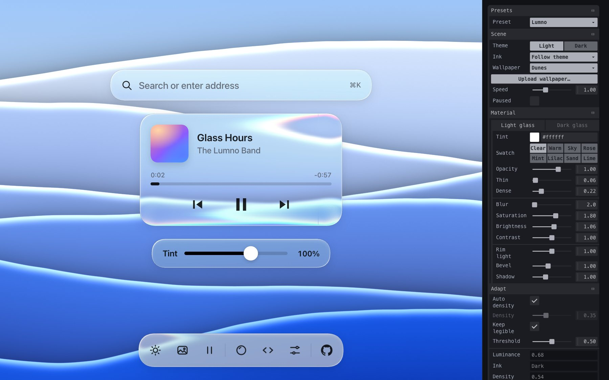
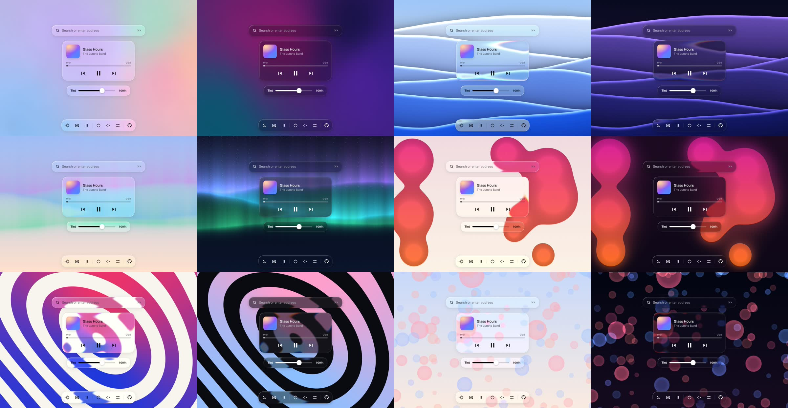
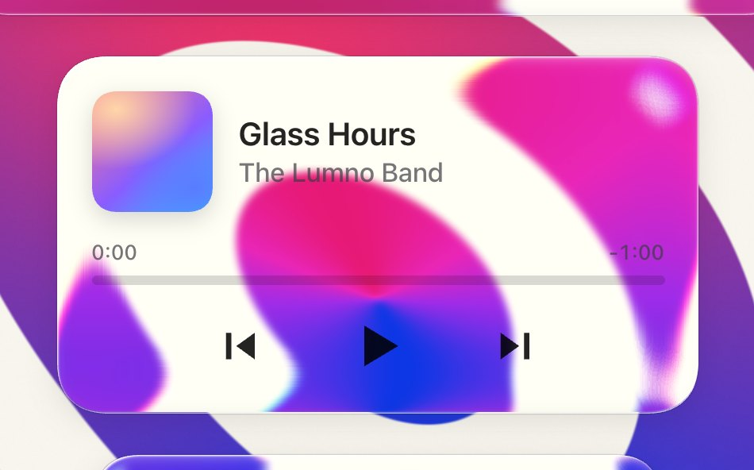
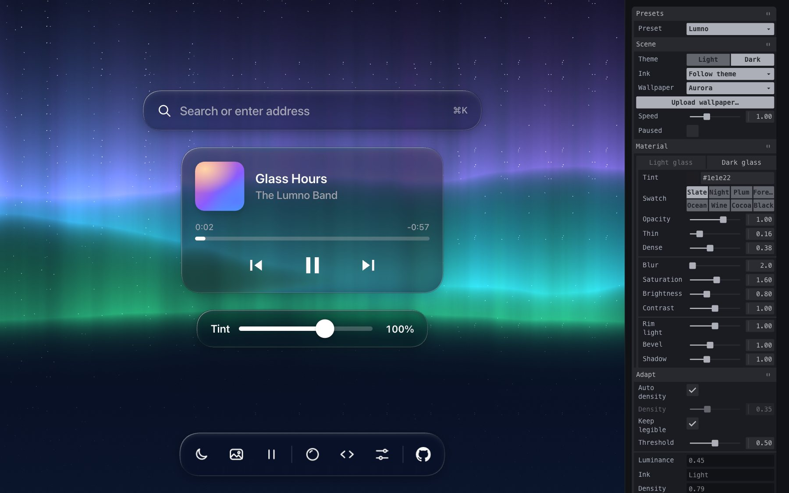
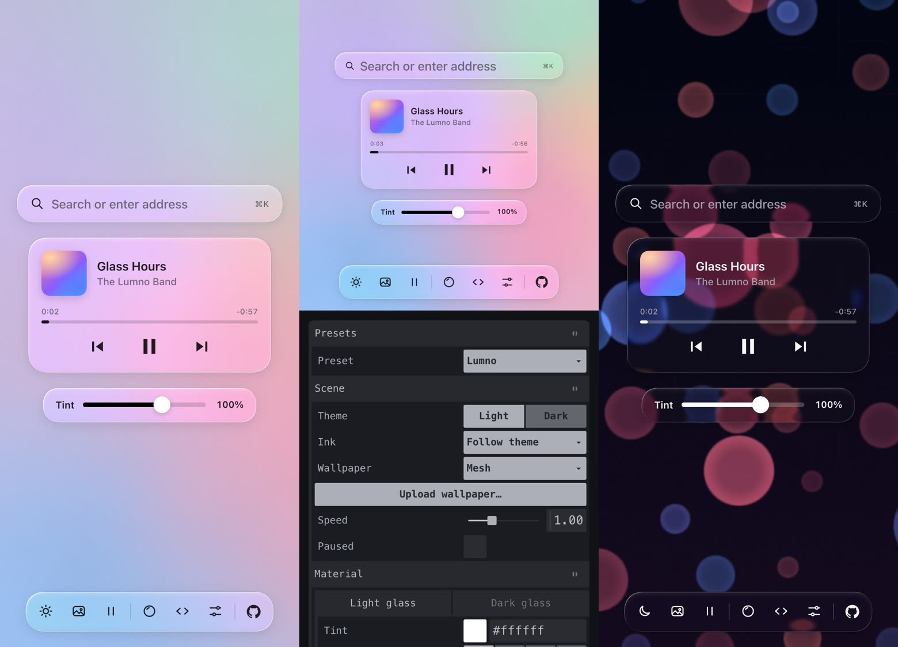

# Glasswork

[English](README.md) · **简体中文**

**一块能拆开、能调、能带走的液态玻璃材质。** Glasswork 是 [Lumno](https://github.com/kubai087/lumno-extension) 新标签页上的玻璃，做成了一个在线 Playground：很薄的着色，颜色来自身后；只模糊 2px，背景保持鲜艳；厚厚的边缘把壁纸往里折，还带色散；边缘光和内侧柔光；文字墨色会读取每块玻璃身后的壁纸，保证可读。所有参数都在面板上，所有设置都写进网址，**复制 CSS** 直接拿走结果。

[](LICENSE)
[](#本地运行)
[](#浏览器支持)
[](https://www.kubai.design/glasswork/)



**[在线体验](https://www.kubai.design/glasswork/?lang=zh)** · [材质原理](#材质原理) · [用到你的产品里](#用到你的产品里) · [Prompt](#prompt) · [网址参数](#设置与网址参数)

## 目录

- [功能](#功能)
- [图集](#图集)
- [材质原理](#材质原理)
- [用到你的产品里](#用到你的产品里)
- [Prompt](#prompt)
- [设置与网址参数](#设置与网址参数)
- [快捷键](#快捷键)
- [本地运行](#本地运行)
- [项目结构](#项目结构)
- [浏览器支持](#浏览器支持)
- [性能](#性能)
- [参与贡献](#参与贡献)
- [致谢、商标与 Tahoe 壁纸](#致谢商标与-tahoe-壁纸)
- [许可证](#许可证)

## 功能

- **整套材质都在面板上。** 浅色玻璃、深色玻璃各一套：染色颜色和色板、染色不透明度（0–150%）、最薄 / 最浓染色、模糊、饱和度、亮度、对比度、边缘光、内侧柔光和阴影。
- **会折射的厚边。** 用 SVG 位移贴图把边缘一圈的背景往里压，像厚玻璃的边，并分出色散。边宽、边缘偏移、衰减和色散都能调，贴图还会跟随 CSS `corner-shape: superellipse()` 的圆角形状。
- **会读壁纸的玻璃。** 每块玻璃每秒采样几次身后的壁纸：背景越杂、越接近文字亮度，着色越浓；背景越鲜艳，饱和度提升保留得越少；可读性底线让正文保持 4.5:1 对比度。文字墨色可以跟随主题（默认）、按每块玻璃身后的壁纸自动切换，或固定深色 / 浅色。
- **七种动态壁纸。** macOS Tahoe 动态壁纸，以及六个用 WebGL 实时绘制、各有浅色和深色两种样子的场景：流光渐变、沙丘、极光、熔岩、波纹和光斑。也可以上传自己的图片或视频，文件不会离开你的浏览器。
- **预设。** Lumno 默认、全透、磨砂、厚玻璃、鲜艳。预设只改材质本身和折射；你设的染色颜色、不透明度、主题、墨色、壁纸和形状都会保留。
- **真实组件。** 搜索框、正在播放卡片、染色滑条和工具栏。前三个可以拖着在壁纸上移动（双击归位），播放器的按钮直接控制壁纸。
- **复制 CSS。** 把当前设置下的浅色、深色玻璃导出成纯 CSS，附带边缘折射需要的那一行 script。
- **设置写在网址里。** 只记录与所选预设不同的值，分享链接打开就是同一块玻璃。
- **手机端。** 舞台铺满屏幕，设置面板从工具栏打开，是底部抽屉。
- **中英文界面**（`?lang=zh`）。

## 图集

六个实时壁纸的浅色和深色，上面是 Lumno 默认的玻璃：



边缘特写：最外沿把背景往回折，并分出彩边，中间保持平整。



深色玻璃，以及手机上的样子：





## 材质原理

组件只改四个声明：`background`、`backdrop-filter`、`box-shadow` 和 `color`，换成材质的变量，结构和布局一行不动。这四个声明底下是六个复合层和一个判断：

1. **投影。** 柔和的投影加一圈细描边，给玻璃体积感。
2. **模糊与提亮。** 背景只模糊 2px，再在滤镜里提高饱和度，浅色玻璃提亮、深色玻璃压暗，玻璃通透鲜艳，不发奶白也不发灰。
3. **边缘折射。** 用 SVG 位移贴图把边缘一圈的背景往里压，越靠边压得越狠，中间保持平整：离边缘 *d* 的点往里看 `边缘偏移 × 边宽 × (1 − d / 边宽) ^ 衰减`。红光比蓝光多弯一点，形成色散。
4. **着色。** 一层很薄的半透明色彩遮罩，透明度在“最薄”和“最浓”之间随背景复杂程度变化，但不低于文字可读所需。
5. **边缘光。** 左上、右下各一道高光，再往内侧缩进一道柔光，让整体更有体积感。
6. **文字着色。** 一种墨色的两档透明度：浅色玻璃上正片叠底，深色玻璃上叠加提亮（plus-lighter），文字不是死板的纯色，而是带一点背景的颜色。
7. **读取壁纸。** 每块玻璃在身后采样 5 × 3 个点，去掉最暗和最亮各两个后取平均。墨色设为“自动”时，亮度低于 0.5 就换成深色玻璃和浅色文字。

推荐参数（Lumno 默认）：

| | 着色 | 模糊 | 饱和度 | 亮度 |
| --- | --- | --- | --- | --- |
| 浅色玻璃 | 白色 6%–22% | 2px | 180% | 1.06 |
| 深色玻璃 | rgb(30 30 34) 16%–38% | 2px | 160% | 0.8 |
| 折射 | 边宽 40–44px、边缘偏移 1.1 倍边宽、衰减 2.6、色散 ±15% | | | |

## 用到你的产品里

### 复制 CSS

在 Playground 里调好，按**复制 CSS**（工具栏的 `</>` 按钮），会得到浅色玻璃（`.glass`）和深色玻璃（`.glass.is-dark`）的四个声明，数值就是你调出来的：

```css
.glass {
  background: rgb(255 255 255 / 0.12);
  -webkit-backdrop-filter: blur(2px) saturate(180%) brightness(1.06);
  backdrop-filter: blur(2px) saturate(180%) brightness(1.06) var(--glass-lens,);
  box-shadow: /* 边缘光、描边、投影和内侧柔光 */;
  color: rgb(0 0 0 / 0.86);
}
.glass > * { mix-blend-mode: multiply; }
```

想自己改的话，仓库里的 `glass.css` 是同一套材质的变量写法。

### 加上边缘折射

折射是一个没有依赖的小模块 `lens.js`：

```html
<script type="module">
  import { liquidGlass } from 'https://cdn.jsdelivr.net/gh/kubai087/glasswork@main/lens.js';
  for (const el of document.querySelectorAll('.glass')) {
    liquidGlass(el, { rim: 40, edge: 1.1, power: 2.6, dispersion: 0.15 });
  }
</script>
```

| 选项 | 默认值 | |
| --- | --- | --- |
| `rim` | `40` | 边宽上限（CSS 像素）。小尺寸组件会缩到短边的 1/3.5。 |
| `edge` | `1.1` | 最外沿往里采样多远，以边宽计。 |
| `power` | `2.6` | 折射在边宽内衰减的快慢。 |
| `dispersion` | `0.15` | 红光比蓝光多弯多少；`0` 为不分色。 |
| `radius`、`corner` | 读取 CSS | 圆角半径和超椭圆指数。 |
| `enabled` | `true` | 关闭折射但不移除。 |

返回 `{ supported, update(options), refresh(), destroy() }`。元素的 `backdrop-filter` 最后要接 `var(--glass-lens,)`；元素尺寸变化时会自动适配。只有 Chromium 能画出 `backdrop-filter` 里的 `url()`；其他浏览器里 `liquidGlass` 什么也不做，保留纯 CSS 的玻璃。想固定版本，把 `@main` 换成 `@v1.0.0`。

`adapt.js` 里是壁纸采样、墨色判断、着色浓度和可读性底线，需要让玻璃读取身后内容时可以一起用。

## Prompt

这套材质发布于《999 个小技巧，让你 Vibe 的产品更有质感》第 010 期（[X 上的帖子](https://x.com/Kubai087/status/2117782193108082923)），附带一段 Prompt，交给 AI 编程助手就能把同样的玻璃用到你的产品上。全文如下（英文原文）。

<details>
<summary><b>展开 Prompt</b></summary>

```text
Give the cards and panels in my product a liquid glass material: clear glass that takes its color from the scene behind it, reads as a thick slab at the rim, adapts to what is behind it, and keeps its text readable in light and dark mode. Work inside my existing design system. This is a change of surface, not of layout: keep my markup, spacing, radii, fonts, icons and copy.

0. Start from what exists
- Find every surface that sits over an image, a wallpaper, video or a busy background: cards, players, search bars, toolbars, menus, popovers, toasts. List them with their component and where they are.
- Find how the product switches between light and dark mode, and where its color tokens live. The glass goes into those tokens, not into each component.
- Leave surfaces over a plain background alone; glass over a flat color only looks gray.

1. The material as tokens
Build it as one set of variables per state, so a surface opts in by using them. The numbers are a starting point, for a UI at its normal size.
- Light glass, dark text (the default): tint white at 6–22% (by density, step 4); backdrop filter blur(2px) saturate(180%) brightness(1.06), so the color comes from behind and stays vivid instead of milky.
  Edge: inset 1.5px 1.5px 1px -1px white 95%, inset -1.5px -1.5px 1px -1px white 55%, inset 0 0 0 0.5px white 30%, 0 0 0 0.5px black 6%, 0 6px 24px black 8%.
  Inner light, on a layer inside the surface: a radial highlight from the top left (white 30% fading out by 55%), and soft inset glows just inside the rim, brighter at the top and left, a little shade at the bottom.
- Light mode over a dark area, light text: tint rgb(16 18 22) at 10–30%; filter blur(2px) saturate(170%), then brightness(0.85); edge: a faint inset white line on top and a 0.5px dark outline.
- Dark mode: tint rgb(20 20 24) at 16–38%; filter blur(2px) saturate(160%) brightness(0.8), which dims like a multiply with black instead of going muddy; the same edge and inner light at about a third of their strength, with a darker outline and shadow.
- Ink, one color in fixed steps, used for everything drawn on the glass:
  on light glass black 86% (titles, icons, times, progress), rgb(60 60 67) at 70% (secondary); mix-blend-mode multiply;
  on dark glass white 94%, rgb(235 235 245) at 64%; mix-blend-mode plus-lighter.
  Draw icons in the opaque color and fade the whole icon with opacity: a translucent color darkens where a shape's strokes and fills overlap.
- A highlighted row on light glass is a lighter layer of the glass: white 42% on hover, 76% when selected, with a white stroke. Never a gray wash.
- Register the numeric and color tokens with @property so a surface glides between states instead of jumping.

2. Apply it in four declarations
Each surface changes only these, and its markup stays as it is:
- background: the tint.
- backdrop-filter: the material's filter, then the rim lens (step 3) last, so the color steps fold into one pass and the bend stays crisp.
- box-shadow: the edge.
- color: the ink, with the blend mode on everything drawn inside.
Hover brightens the tint by about 14% instead of lifting a shadow.

3. The rim lens
- Build a displacement map for each surface: red is the sideways bend, green the vertical one, 128 is none. Only a rim bends; the middle stays flat.
- The rim is about 44px wide on a card (min(44px, the short side / 3.5), never under 4px). For a thick slab, a point d from the edge looks inward by 1.1 × rim × (1 - d / rim)^2.6: hard at the edge, where the scene folds back on itself, easing to nothing at the rim's inner edge.
- Draw the map for the same corner the CSS draws. If the surface uses corner-shape: superellipse(), follow that curve, not a circle, or the bend and the rim light miss each other at the corners.
- Put it in an SVG filter with feImage (the map) and feDisplacementMap (scale = 2 × the largest offset), and add url(#id) at the end of backdrop-filter.
- Split it into colors: three passes, red 15% further and blue 15% less, each kept to its channel with feColorMatrix and added back with screen blends. Check the corners of wide rims over busy backgrounds; lower the split where it turns into a haze.
- Only Chromium draws url() in backdrop-filter. Check CSS.supports('backdrop-filter', 'url(#a)') and skip Firefox, which parses it and draws nothing. Everywhere else the CSS-only glass stays.
- Wait for the map image to decode before pointing a surface at the filter, or it draws without its blur. Give every filter a unique id and its own <svg>. Build maps once per radius and rim width and reuse them; on resize, move the map, don't rebuild it.
- Skip the lens on surfaces under 32px, and on surfaces with will-change or their own compositing layer (menus, animated panels), where Chrome can draw the map instead of the bent backdrop.

4. Adapt to what is behind
- For each surface, sample the background under it at a 5 × 3 grid, drop the two darkest and two brightest points, and average. Luminance is (0.299 R + 0.587 G + 0.114 B) / 255; texture is the brightest point minus the darkest.
- Ink: in light mode, light text when the luminance is under 0.5. Keep the current ink within ±0.05 of the line so a surface never flickers at it. Dark mode is always light text. Neighbouring surfaces in one row share one decision.
- Density (0 thin, 1 dense) = 0.55 × how close the background is to the ink's own brightness + 0.7 × texture + 0.3 × chroma. It moves the tint between its thin and dense alpha.
- Saturation kept = 1 - 0.75 × chroma, at least 0.45, so a vivid background doesn't stain the glass.
- Sample again when the background, the theme or a surface's position changes, and remember the last ink so the next load opens in it.
- If the background is not an image you can read (live video, cross-origin content), pick the ink from the theme and use the dense tint.

5. Let people set the tint
- Add one setting for light mode and one for dark that scale the tint, from 0 to 1.5 (1 is the material as designed). Below 1 the brightness lift in the filter thins with it, so at 0 only the blur, the rim and the shadow are left.
- Each theme keeps its own value; switching themes glides to that theme's value.

6. Keep it accessible
- Check text contrast on the busiest and the darkest background the product allows, at the default tint; raise density, not the ink's opacity, until it passes.
- Respect prefers-reduced-transparency and forced colors: fall back to a solid surface in the same tint at full opacity.
- Keep focus rings, disabled states and error colors as they are; failures keep their red.

7. Deliver
- First list the surfaces you will change, which get the lens and the color split, and which you leave solid and why.
- Then add the tokens, the lens helper and the two settings, switch the surfaces over, and list every file you touched.
- Don't change layout, fonts, radii or copy. If a surface would need a new component to work as glass, stop and ask me first.
```

</details>

## 设置与网址参数

所有设置都写在地址栏里，只记录与所选预设不同的值，刷新或分享链接都能打开同一块玻璃。也可以手写，例如 `?wallpaper=aurora&theme=dark&rim=56`。

| 参数 | 取值 | |
| --- | --- | --- |
| `preset` | `lumno`、`clear-glass`、`frosted`、`thick-slab`、`vivid` | 其他值的起点 |
| `theme` | `light`（默认）、`dark` | |
| `wallpaper` | `tahoe`（默认）、`mesh`、`dunes`、`aurora`、`lava`、`lines`（波纹）、`bokeh` | |
| `speed`、`paused` | `0`–`3`；`0` 或 `1` | 壁纸的运动 |
| `ink` | `theme`（默认）、`auto`、`dark`、`light` | `auto` 按每块玻璃身后的壁纸切换 |
| `autoDensity`、`density` | `0` 或 `1`；`0`–`1` | 着色浓度跟随壁纸，或手动设置 |
| `legible`、`threshold` | `0` 或 `1`；`0.2`–`0.8` | 可读性底线；自动墨色的换色阈值 |
| `lens`、`rim`、`edge`、`power`、`dispersion` | `0` 或 `1`；`4`–`96`；`0`–`2.5`；`1`–`6`；`0`–`0.4` | 边缘折射 |
| `radius`、`smoothing` | `0`–`60`；`0.5`–`3` | 圆角和超椭圆平滑度 |
| `l.<key>`、`d.<key>` | | 浅色 / 深色玻璃：`tint`（十六进制）、`opacity`（`0`–`1.5`）、`thin`、`dense`、`blur`、`saturation`、`brightness`、`contrast`、`rimLight`、`bevel`、`shadow` |
| `lang` | `en`（默认）、`zh` | 面板语言 |
| `ui` | `0` 或 `1` | 启动时隐藏或显示面板 |

## 快捷键

| 按键 | |
| --- | --- |
| `H` | 显示 / 隐藏面板 |
| `T` | 切换浅色 / 深色 |
| `W` | 下一张壁纸 |
| `空格` | 暂停 / 播放壁纸 |

双击组件可以让它回到原位。鼠标悬停在工具栏按钮上会显示对应的快捷键。

## 本地运行

不需要构建，也不用安装任何东西。用 HTTP 打开这个文件夹即可（ES 模块和视频无法从 `file://` 加载）：

```bash
git clone https://github.com/kubai087/glasswork.git
cd glasswork
python3 -m http.server 8000
```

然后打开 <http://localhost:8000>。浏览器控制台里的 `window.__glass` 包含 `state`、`materials`、`pane` 和 `apply()`。

## 项目结构

```
index.html      页面：舞台、四块玻璃、设置面板和复制 CSS 弹窗
glass.css       材质本身，写成变量：两种材质和四个声明
lens.js         边缘折射，可单独使用的模块
adapt.js        壁纸采样：墨色、着色浓度、饱和度和可读性底线
wallpapers.js   六个用 WebGL 2 实时绘制的壁纸
playground.js   设置、预设、网址、拖动、工具栏和复制 CSS
panel.js        从 jsDelivr 加载 Tweakpane，加载失败时有替身
i18n.js         英文和简体中文
style.css       页面布局和各组件自己的样式
media/          README 图片，以及 Tahoe 视频（见下文）
```

## 浏览器支持

| | 玻璃 | 边缘折射 | 实时壁纸 |
| --- | --- | --- | --- |
| Chrome、Edge、Arc、Brave 等 Chromium 浏览器 | ✓ | ✓ | ✓ |
| Safari（macOS 和 iOS）、iOS 上的所有浏览器 | ✓ | — | ✓ |
| Firefox | ✓ | — | ✓ |

没有折射时，玻璃仍保留着色、模糊、边缘光和墨色。圆角平滑度需要 CSS `corner-shape`（Chromium 139+），其他浏览器是普通圆角。不支持 WebGL 2 时，列表里不会出现实时壁纸。

## 性能

- 边缘折射按每种边宽和圆角生成九宫格贴图，解码一次后共享；组件尺寸变化时只移动贴图，不重新生成。
- 壁纸按舞台的 1/4 尺寸采样，每秒五次，壁纸静止时不采样。
- 实时壁纸最多按 1.5 倍像素密度绘制（触屏设备为 1 倍），暂停或页面隐藏时停止绘制。
- 只有选中 Tahoe 时才会加载 Tahoe 视频。

## 参与贡献

欢迎报告问题、贡献新的预设、壁纸和修复，详见 [CONTRIBUTING.md](CONTRIBUTING.md)。安全问题请看 [SECURITY.md](SECURITY.md)。

## 致谢、商标与 Tahoe 壁纸

- 材质来自 Lumno 的新标签页（[lumno-extension](https://github.com/kubai087/lumno-extension)）。
- **Tahoe 壁纸属于 Apple。** `media/tahoe-light.mp4`、`media/tahoe-dark.mp4`、`media/tahoe-light.webp` 和 `media/tahoe-dark.webp` 截自 macOS Tahoe 的动态壁纸，© Apple Inc.。放在这里只是为了让在线演示能展示玻璃在它原本设计时所用壁纸上的效果。**它们不在本项目的许可范围内**，不能依本项目的许可证复用或再分发；基于本项目的代码做东西时，请把它们去掉。详见 [NOTICE](NOTICE)。如权利人要求，会立即移除。
- Glasswork 是独立项目，**与 Apple Inc. 没有任何关联，也未获其认可或赞助**。Apple、macOS、macOS Tahoe 和 Liquid Glass 是 Apple Inc. 的商标；这里的“液态玻璃”指的是 Lumno 自己的材质。
- 六个实时壁纸，以及 `media/` 中除 Tahoe 文件外的所有图片，都是本项目原创。
- [Tweakpane](https://tweakpane.github.io/docs/) 和 [@tweakpane/plugin-essentials](https://github.com/tweakpane/plugin-essentials) 采用 MIT 许可，从 jsDelivr 加载。

## 许可证

[MIT](LICENSE) © Kubai087，涵盖代码以及 `media/` 中由本项目渲染的图片；不包含上面列出的四个 Tahoe 文件（见 [NOTICE](NOTICE)）。
